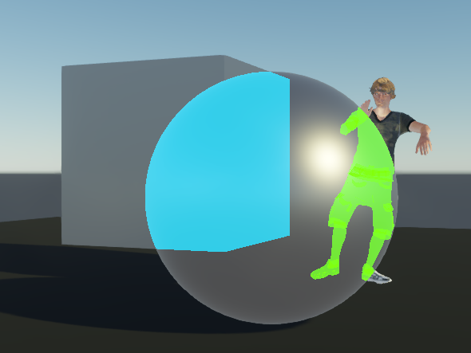

# Stride Extensions

A growing collection of reusable extensions for the [Stride Game Engine](https://www.stride3d.net).

## Extensions

| Extension                                                   | Description                                                                                              | Sample Image                                              |
| ----------------------------------------------------------- | -------------------------------------------------------------------------------------------------------- | --------------------------------------------------------- |
| [Occlusion Silhouette](StrideOcclusionSilhouette/Readme.md) | Renders a flat-colored silhouette for entities hidden behind other geometry (X-ray / see-through effect) |  |

More extensions are planned.

## Demo

The **StrideExtensionsDemo** project showcases the available extensions. Currently it demonstrates the Occlusion Silhouette feature.

## License

MIT
