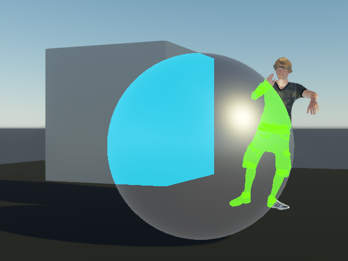

# Occlusion Silhouette

Renders a flat-colored silhouette for entities that are hidden behind other geometry — an X-ray / see-through effect. The silhouette has a subtle animated pulse. Skinned/animated meshes are supported, and for materials whose shape lies in their alpha (e.g. a quad with a cut-out symbol) the silhouette takes the shape the material shows.

Self-occlusion is suppressed via the stencil buffer: the entity's own pixels are marked during the opaque pass and excluded during the silhouette pass.

## Install

Add the `GoldenBorder.StrideOcclusionSilhouette` package to your project via NuGet.

## Setup

### 1. Graphics Compositor

Open your **Graphics Compositor** and locate the render stages.

**Add a new render stage:**

| Property    | Value                               |
| ----------- | ----------------------------------- |
| Name        | `OcclusionSilhouette` (or any name) |
| Effect Name | `OcclusionSilhouetteEffect`         |

Locate and select the `MeshRenderFeature` in the render feature section.

**Add a `SimpleGroupToRenderStageSelector`** to `MeshRenderFeature → Render Stage Selectors`:

| Property     | Value                         |
| ------------ | ----------------------------- |
| Render Group | `All` (or restrict as needed) |
| Render Stage | _(the stage created above)_   |
| Effect Name  | `OcclusionSilhouetteEffect`   |

**Add the render feature** to `MeshRenderFeature → Render Features`:

| Property                | Value                                         |
| ----------------------- | --------------------------------------------- |
| Type                    | `Occlusion Silhouette`                        |
| Render Group            | `All` (or restrict as needed)                 |
| Opaque Render Stage     | _(your existing opaque stage, e.g. `Opaque`)_ |
| Silhouette Render Stage | _(the stage created above)_                   |

**Add the silhouette stage to the render pipeline** after the opaque pass (e.g. before transparency or post-processing):
- Click at the `Entry Points`
- Extend the scene renderer collection at `Game Renderer -> Child -> Children` by a new `SingleStageRenderer` referencing the silhouette stage created above.

### 2. Per Entity

Add an **`OcclusionSilhouette`** component (found under _Rendering_ in the component picker) to any entity that should show a silhouette when occluded.

| Property           | Description                       | Default            |
| ------------------ | --------------------------------- | ------------------ |
| `Silhouette Color` | RGBA color of the silhouette      | Cyan, 60 % opacity |
| `Enabled`          | Toggles the effect on this entity | `true`             |

## How it works

1. **Opaque pass** — stencil bit `0x01` is written wherever the entity's own pixels appear.
2. **Silhouette pass** — geometry is re-drawn with depth test `Greater` (only behind other objects) and stencil test `NotEqual 1` (skip the entity's own surface). The `OcclusionSilhouetteShader` outputs the configured flat color with a `sin`-based pulse.

### Materials with transparency

The silhouette follows the material's alpha, so it shows the shape the material shows. Nothing needs to be set up for this — the shape comes from the material itself.

| Material transparency | Silhouette                                                                                                                                  |
| --------------------- | ------------------------------------------------------------------------------------------------------------------------------------------- |
| None (opaque)         | Covers the whole geometry, as before. No extra cost.                                                                                        |
| Blend                 | Covers as much as the material's alpha: fully transparent areas stay free, soft edges stay soft.                                           |
| Cutoff                | Covers fully wherever the material is drawn, nothing where it is cut off.                                                                   |
| Additive              | Covers as much as the material's output alpha. Stride's default Additive alpha (0.5) is already fully additive and shows no silhouette. |

Which path a material takes follows Stride's own rule for depth-only passes: every material that needs its pixel shader there (`MaterialKeys.UsePixelShaderWithDepthPass` — Blend, Additive and Cutoff transparency, and the Hair shading model even without transparency) runs its pixel stage in the silhouette pass (`OcclusionSilhouetteMaterialShader`) to read its alpha; no light is evaluated. All other materials keep the flat path.
